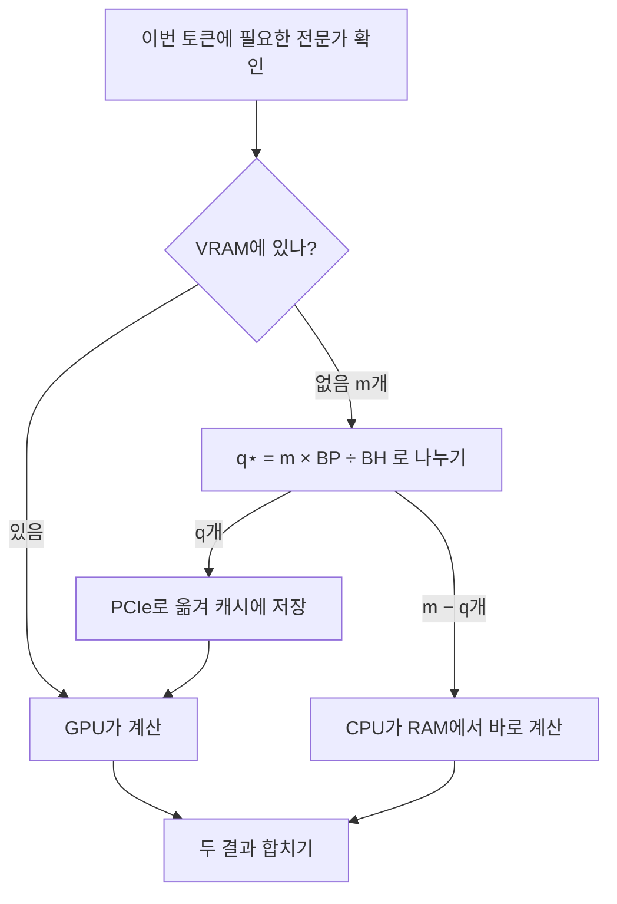

# FreeToken 쉽게 이해하기

> 집에 있는 컴퓨터로 초대형 AI를 빠르게 돌리는 방법

이 글은 FreeToken 논문([arXiv 2608.16157v1](https://arxiv.org/html/2608.16157v1))을 중학생도 읽을 수 있게 풀어 쓴 것입니다. 도서관 비유와 계산 예시는 설명을 위해 새로 붙였고, 논문에 없는 내용은 그렇다고 표시했습니다.

## 한 문장 요약

FreeToken은 **AI 모델 전체를 그래픽카드에 넣지 못해도, 지금 필요한 부분만 그때그때 잘 옮기고 컴퓨터의 모든 부품에 일을 나눠서** 큰 모델을 빠르게 돌리는 프로그램입니다.

논문에 따르면 8GB 그래픽카드 노트북에서 350억 개 파라미터 모델을 초당 39.3토큰으로 돌렸습니다. 코딩 AI인 Codex의 실사용 속도 중간값이 초당 33토큰이니, 그보다 빠릅니다([논문 §1, §5.3](https://arxiv.org/html/2608.16157v1#S5.SS3)).

## 1. 먼저 알아야 할 낱말

| 낱말 | 뜻 |
|---|---|
| 토큰 | AI가 글을 처리하는 조각. 단어나 단어의 일부 정도 |
| 파라미터 | AI가 배운 지식을 담은 숫자. 35B는 350억 개 |
| GPU와 VRAM | GPU는 계산이 아주 빠른 그래픽카드, VRAM은 그 안의 메모리 |
| CPU와 RAM | CPU는 컴퓨터의 일반 두뇌, RAM은 그 메모리. VRAM보다 크지만 느림 |
| PCIe | RAM과 GPU를 잇는 통로 |
| 대역폭 | 통로로 1초에 옮길 수 있는 데이터 양 (GB/s) |

## 2. 왜 큰 AI는 집에서 돌리기 어려울까?

요즘 큰 AI 중에는 **MoE(Mixture of Experts, 전문가 혼합)** 라는 구조가 많습니다. 모델 안에 "전문가(expert)"라고 부르는 숫자 묶음이 잔뜩 있고, 토큰 하나를 처리할 때는 그중 몇 개만 씁니다. 수학 전문가, 역사 전문가처럼 분야가 나뉜다는 뜻은 아니고, 그냥 계산 담당 묶음이라고 생각하면 됩니다.

예를 들어 DeepSeek-V4-Flash는 43개 층마다 전문가 256명 중 6명만 일합니다. 그래서 파라미터 2,840억 개 중 토큰 하나에 쓰이는 것은 130억 개뿐입니다([논문 §1](https://arxiv.org/html/2608.16157v1#S1)).

좋은 소식과 나쁜 소식이 함께 있습니다.

- **좋은 소식:** 한 번에 쓰는 양이 적어서 계산은 감당할 만합니다.
- **나쁜 소식:** 언제 어떤 전문가가 필요할지 모르니, 전문가 전체를 어딘가에 보관하고 필요할 때 꺼내 와야 합니다.

## 3. 비유: 도서관과 내 책상

이 글 전체에서 쓸 비유입니다.

| 컴퓨터 | 비유 |
|---|---|
| 전문가 | 참고서 한 권 |
| VRAM | 내 책상. 좁지만 바로 펼쳐 볼 수 있음 |
| GPU | 책상에 앉은 아주 빠른 학생 |
| RAM | 도서관 서가. 모든 책의 원본이 있음 |
| CPU | 서가 앞에 서서 그 자리에서 책을 읽는 친구. 느림 |
| PCIe | 서가에서 책상으로 책을 나르는 복도 |

AI가 일하는 단계는 둘입니다.

- **프리필(prefill):** 질문과 지금까지의 대화를 읽는 단계. 첫 글자가 나올 때까지 걸리는 시간(TTFT)을 좌우합니다.
- **디코드(decode):** 답을 한 토큰씩 쓰는 단계. 답이 나오는 속도를 좌우합니다.

그리고 어려운 점이 세 가지 있습니다([논문 §2](https://arxiv.org/html/2608.16157v1#S2)).

1. **프리필:** 긴 글을 읽으면 토큰마다 찾는 책이 달라서 결국 거의 모든 책이 필요합니다. 게다가 코딩 AI 같은 에이전트는 대화 기록을 자주 고치기 때문에, 이미 읽은 부분을 다시 읽는 일이 생깁니다.
2. **디코드:** 필요한 책이 책상에 없을 때(캐시 미스) 나르자니 복도가 좁고, 친구에게 맡기자니 느립니다. 어느 쪽이 나은지는 컴퓨터마다 다릅니다.
3. **자원:** 개인 컴퓨터는 AI 전용이 아닙니다. 브라우저나 게임이 언제든 책상 자리를 차지할 수 있습니다.

## 4. FreeToken의 원리

해결책은 세 가지 아이디어입니다. 어려운 점 세 가지에 하나씩 대응합니다.

### 아이디어 1: 프리필은 "미리 나르기"와 "책갈피"로

**책 두 묶음 돌려쓰기(더블 버퍼링).** 어차피 거의 모든 책이 필요하니, 한 층의 책을 통째로 나릅니다. 학생이 1층 책으로 공부하는 동안 복도에서는 2층 책을 미리 옮겨 둡니다. 다 읽으면 두 자리의 역할을 바꿉니다. 이렇게 하면 책이 오기를 기다리며 노는 시간이 사라집니다.

실제로 이 기능을 끄면 프리필 속도가 19~26% 떨어졌습니다([논문 §5.3](https://arxiv.org/html/2608.16157v1#S5.SS3)).

**문단 끝에 책갈피 꽂기(시맨틱 앵커).** 게임의 세이브 포인트와 비슷합니다. 세이브 데이터(체크포인트)는 용량이 커서 몇 개만 둘 수 있으니, 위치를 잘 골라야 합니다.

에이전트 프로그램은 대화 기록을 아무 데나 고치지 않고 "생각 내용", "도구 호출", "도구 결과" 같은 **덩어리 단위로** 지웁니다. 그래서 FreeToken은 바로 그 덩어리 경계에 세이브합니다. 기록이 고쳐져도 경계까지의 세이브는 살아남으므로, 그 뒤에 새로 생긴 부분만 다시 읽으면 됩니다.

### 아이디어 2: 디코드는 "최근 쓴 책 두기"와 "일 나누기"로

**최근에 쓴 책을 책상에 두기(LRU 캐시).** 바로 옆 토큰끼리는 비슷한 전문가를 찾는 경향이 있습니다. 그래서 자리가 모자라면 **가장 오랫동안 안 쓴 책**을 치웁니다. 책상에 3권이 들어갈 때 예를 들면 이렇습니다.

| 찾는 책 | 결과 | 책상 (왼쪽일수록 오래 안 씀) |
|---|---|---|
| A | 없음, 가져옴 | A |
| B | 없음, 가져옴 | A B |
| C | 없음, 가져옴 | A B C |
| A | 있음! | B C A |
| D | 없음, B를 치우고 가져옴 | C A D |

같은 책상 크기로 비교했더니 찾는 책이 책상에 없는 비율이 크게 줄었습니다([논문 §5.3](https://arxiv.org/html/2608.16157v1#S5.SS3)).

| 모델 (RTX 5090 기준 책상 크기) | FreeToken | KTransformers | llama.cpp |
|---|---|---|---|
| Qwen3.6 (전체의 37%) | 16% | 41% | 62% |
| DeepSeek-V4-Flash (전체의 11%) | 39% | 59% | 89% |

**없는 책은 복도와 친구에게 나누기(q⋆ 정책).** FreeToken의 핵심입니다. 책상에 없는 책이 m권일 때, 그중 q권은 복도로 나르고(GPU가 처리) 나머지는 친구가 서가에서 처리합니다(CPU가 처리). 나눌 비율은 공식 하나로 정합니다([논문 §3.2](https://arxiv.org/html/2608.16157v1#S3.SS2)).

```
q⋆ = m × (BP ÷ BH)
```

- `BP`: 복도(PCIe)로 나를 수 있는 속도
- `BH`: 서가(RAM과 CPU)가 낼 수 있는 전체 속도

**왜 이 공식일까요?** 복도로 나르는 일도 서가에서 책을 꺼내야 하므로, 복도와 친구는 서가의 속도를 나눠 씁니다. 복도가 BP만큼 쓰면 친구에게는 `BH − BP`만 남습니다. 두 일을 동시에 시작하면 늦게 끝나는 쪽을 기다려야 하니, **둘이 동시에 끝나도록** 나누는 것이 가장 빠릅니다.

```
나르는 시간 = 친구가 처리하는 시간
q ÷ BP = (m − q) ÷ (BH − BP)
→ 정리하면 q = m × BP ÷ BH
```

**노트북으로 계산해 봅시다.** RTX 4060 노트북은 BP가 11.8, BH가 47.5 GB/s입니다. 없는 책이 4권이고, 계산하기 쉽게 한 권을 1GB라고 가정합니다(실제 크기는 모델마다 다릅니다).

- q⋆ = 4 × 11.8 ÷ 47.5 ≈ 0.99이므로 **1권은 나르고 3권은 친구가 처리**합니다.
- 나르기: 1 ÷ 11.8 ≈ 0.085초
- 친구: 3 ÷ (47.5 − 11.8) ≈ 0.084초. 거의 동시에 끝납니다!
- 4권을 전부 나른다면 4 ÷ 11.8 ≈ 0.34초로, 이번 층만 보면 약 4배 느립니다.

컴퓨터가 다르면 답도 달라집니다. 아래 표의 대역폭은 논문 Table 1의 측정값이고, 나눈 결과는 이 글에서 없는 책 4권으로 직접 계산한 것입니다(반올림 가정).

| 컴퓨터 | BP | BH | 나르기 / 친구 |
|---|---|---|---|
| RTX 4060 노트북 | 11.8 | 47.5 | 1 / 3 |
| RTX PRO 6000 | 51.5 | 178 | 1 / 3 |
| RTX 5090 서버 | 52.7 | 77.3 | 3 / 1 |
| RTX 5090 데스크톱 | 49.0 | 53.8 | 4 / 0 |

복도가 좁은 노트북은 친구에게 많이 맡기고, 복도가 넓고 서가에 여유가 적은 데스크톱은 거의 나릅니다. **설명서의 숫자가 아니라 그 컴퓨터에서 실제로 잰 값**을 쓰는 것이 중요합니다.

참고로 FreeToken은 최소 1권은 항상 나릅니다. 그래야 책상이 계속 갱신되어 다음 토큰에 도움이 되기 때문입니다. 그리고 GPU와 CPU의 계산 결과를 합치면 정확히 원래 모델의 결과가 됩니다. 속도를 위해 답의 품질을 깎는 근사 방식이 아닙니다.

한 층에서 일어나는 일을 그림으로 보면 이렇습니다.



### 아이디어 3: 책상 크기가 바뀌어도 괜찮게

책의 **원본은 항상 도서관(RAM)에** 있고 책상에는 복사본만 둡니다. 그래서 책상이 좁아져도 느려질 뿐 답이 틀리지는 않습니다. 논문은 이 성질을 "GPU 메모리는 성능에만 영향을 주고 정확성에는 영향을 주지 않는다"고 표현합니다([논문 §3.3](https://arxiv.org/html/2608.16157v1#S3.SS3)).

- **실행 중 크기 조절:** 게임을 켜서 VRAM이 줄면, 안전한 시점에 책상을 다시 꾸밉니다. 프로그램을 재시작하거나 도서관을 다시 채울 필요가 없습니다.
- **빠른 시작:** 디스크에서 RAM으로 책을 옮길 때 최종 배치 그대로 바로 넣습니다. 준비 운동(웜업)도 없앴습니다. 첫 요청은 빈 책상으로 시작해서 일하면서 채웁니다.

## 5. 구현 방법

원리를 실제 프로그램으로 만들 때의 문제와 해법입니다([논문 §4](https://arxiv.org/html/2608.16157v1#S4)). 맨바닥부터 만든 것은 아닙니다. SGLang, vLLM 같은 기존 서빙 시스템의 구조를 따르고 FlashInfer, Flash Linear Attention 같은 라이브러리를 씁니다.

### 5.1 결정을 GPU 안에서 내리기

**문제:** 어떤 책을 치울지는 토큰마다, 층마다 달라집니다. 이걸 매번 CPU에게 물어보면 왕복 시간 때문에 느려집니다.

**해법:** 결정까지 GPU가 직접 합니다. 여기서 쓰는 것이 **CUDA Graph**인데, GPU가 할 일을 미리 녹화해 두고 재생하는 기능입니다. 재생은 빠르지만 녹화된 동작이 바뀌면 안 되므로, "바뀌는 내용"을 "동작"이 아니라 **데이터**로 만듭니다.

비유하면 주문서 양식을 칸 수까지 고정해 두고, 맨 위에 "앞에서 3칸만 유효"라고 적는 것입니다. 일하는 순서는 늘 같고, 양식에 적힌 내용만 달라집니다.

각 층에서 GPU 프로그램(커널)이 하는 일은 다음과 같습니다.

1. 찾는 전문가 목록에서 중복을 없앱니다.
2. 책상에 있는 것과 없는 것으로 나눕니다.
3. 대역폭 공식으로 나를 개수 q를 구합니다.
4. 치울 책을 고릅니다.
5. 전문가 번호를 "책상 칸 번호" 또는 "CPU 담당 표시"로 바꿔 적습니다.

**치울 책 고르기의 요령:** 한 권 치울 때마다 책상 전체를 훑으면 느립니다. 그래서 한 번만 훑어서 치울 후보 K권을 한꺼번에 뽑고, 실제로는 앞에서 q권(q ≤ K)만 씁니다. 몇 권이 없든 훑는 횟수는 항상 한 번입니다.

**한 번에 옮기기:** 옮길 목록을 하나로 합쳐 큰 전송 한 번으로 처리합니다. 덕분에 GPU 프로그램을 실행하는 횟수가 적고 PCIe를 꽉 채워 쓸 수 있습니다.

### 5.2 CPU 일도 녹화에 포함하기

CPU가 맡는 부분까지 같은 CUDA Graph에 넣습니다. GPU→RAM 복사, CPU에게 일 넘기기, GPU 계산, 서로 기다리기, 결과를 GPU로 돌려주기가 모두 한 녹화본에 들어갑니다. 그래서 토큰마다 Python이 일정을 짤 필요가 없습니다.

CPU 쪽 일꾼은 다음처럼 만듭니다.

- **C++ 일꾼 풀:** 일꾼들을 계속 살려 두고 물리 코어에 하나씩 고정합니다.
- **SIMD:** CPU가 숫자 여러 개를 한 번에 계산하는 기능을 씁니다.
- **압축 풀기:** 압축된 가중치를 계산하면서 바로 풉니다.

### 5.3 전문가를 저장하는 방법

**번호 하나로 통일.** 모델마다 파일 구조가 달라서, 전문가 데이터를 몇 개의 큰 표(bank)로 정리합니다. 전문가 번호는 이렇게 계산합니다.

```
번호 = 층 번호 × 층당 전문가 수 + 전문가 번호
```

층당 전문가가 256명이면 2번 층의 5번 전문가는 2 × 256 + 5 = 517번입니다. 모든 표에서 517번 줄을 모으면 전문가 한 명이 완성됩니다. GPU와 CPU가 같은 번호로 부르니 헷갈리지 않고, 위에서 말한 "한 번에 옮기기"도 이 덕분에 가능합니다.

**FTW 파일 형식.** 실행할 때 쓸 배치 그대로 미리 저장해 둔 파일입니다. 시작할 때 파일을 뒤져 다시 정리하는 과정을 건너뛰고, 여러 조각을 동시에 RAM으로 곧장 읽습니다.

**채운 다음에 고정하기.** 전송에 쓸 메모리는 고정(pin)해야 합니다. 빈 메모리를 먼저 고정하면 기가바이트 단위로 0을 채운 뒤 다시 덮어쓰는 낭비가 생기므로, 먼저 채우고 나서 고정합니다.

### 5.4 컴퓨터에 맞추기

시작할 때 GPU 종류와 CPU 기능에 맞는 프로그램을 자동으로 고릅니다. 운영체제나 드라이버 제약으로 전문가 전체를 고정할 수 없으면 **CPU 전용 모드**로 바꿉니다. 전문가 계산은 모두 CPU가 하고 나머지 층만 GPU에 둡니다. 최고 속도는 포기해도 돌아가게 만드는 선택입니다.

### 5.5 코드 흐름으로 다시 보기

아래는 이해를 돕기 위해 이 글에서 단순하게 적은 의사코드입니다. **실제 FreeToken 코드가 아닙니다.** 실제로는 GPU 커널과 C++로 나뉘어 동작합니다.

```python
# 시작할 때: 그 컴퓨터에서 직접 측정한다
BP, BH = 측정한_PCIe_속도(), 측정한_CPU_쪽_속도()

def 한_층_계산(입력, 층):
    필요 = 중복_제거(라우터가_고른_전문가(입력, 층))
    있음 = [e for e in 필요 if e in 캐시]
    없음 = [e for e in 필요 if e not in 캐시]

    q = max(1, round(len(없음) * BP / BH)) if 없음 else 0
    나를것, CPU몫 = 없음[:q], 없음[q:]

    CPU결과 = CPU에서_동시에_시작(CPU몫, 입력)  # CPU 먼저 출발
    캐시.오래된_것을_치우고_복사(나를것)         # 남는 칸이 없으면 LRU로 치움
    GPU결과 = GPU_계산(있음 + 나를것, 입력)

    return GPU결과 + CPU결과.기다리기()          # 합치면 원래 모델과 같은 결과
```

## 6. 결과는 어땠을까?

모두 논문 저자들이 직접 측정해 보고한 값입니다([논문 §5](https://arxiv.org/html/2608.16157v1#S5)).

**돌릴 수 있는 모델**

| 컴퓨터 | 모델 크기 | 속도 |
|---|---|---|
| RTX 4060 노트북 (8GB) | 35B | 초당 39.3토큰 |
| RTX 5090 (32GB) | 35B | 초당 77~83토큰 |
| RTX 5090 (32GB) | 284B | 초당 22~25토큰 |
| RTX PRO 6000 (96GB) | 753B | 초당 14.9토큰 (llama.cpp는 7.3) |

**기존 프로그램과 비교**

- **답 쓰는 속도:** RTX 5090에서 가장 좋은 경쟁 프로그램보다 1.5~2.3배 빠릅니다.
- **안정성:** 에이전트 작업에서도 단일 질문 때와 속도 차이가 12% 이내입니다.
- **가장 오래 기다린 경우:** 첫 토큰까지 FreeToken은 44초 미만입니다. llama.cpp는 232초, Ollama는 179초, KTransformers는 946초까지 걸렸습니다. OpenClaw는 120초 동안 응답이 없으면 요청을 포기하므로, 이 차이는 "되느냐 안 되느냐"의 문제가 됩니다.

다만 모든 항목에서 이긴 것은 아닙니다. 평균 첫 토큰 시간에서 짧은 단일 질문은 llama.cpp가, Qwen3.6과 Claude Code 조합은 KTransformers가 더 좋았습니다([논문 §5.2](https://arxiv.org/html/2608.16157v1#S5.SS2)).

## 7. 정리

| 문제 | FreeToken의 해결책 | 비유 |
|---|---|---|
| 프리필 때 전문가 옮기느라 대기 | 더블 버퍼링 | 공부하는 동안 다음 책을 미리 나르기 |
| 대화가 고쳐져 처음부터 다시 읽음 | 시맨틱 앵커 | 문단 끝에 세이브 |
| 필요한 전문가가 VRAM에 없음 | LRU 캐시 | 최근 쓴 책을 책상에 두기 |
| 없는 전문가를 어떻게 처리할까 | q⋆ 정책 | 복도와 친구가 동시에 끝나게 나누기 |
| VRAM이 수시로 변함 | 실행 중 재구성 | 원본은 도서관에 두고 책상만 다시 꾸미기 |
| 매번 시작이 느림 | FTW 형식, 웜업 제거 | 정리된 상태로 보관, 일하면서 채우기 |

논문의 결론은 이렇습니다. 이제 로컬 AI의 한계를 정하는 것은 하드웨어만이 아니라, **이미 가진 부품을 얼마나 잘 조합하는 소프트웨어인가**이기도 합니다.

## 8. 읽을 때 주의할 점

- **검증 범위:** 논문 v1 하나만 근거로 썼습니다. 수치는 저자 측 측정값이며, 직접 재현하거나 다른 곳의 검증을 찾아보지는 않았습니다.
- **코드:** [공식 저장소](https://github.com/FlashML-org/FreeToken)가 있다는 것만 확인했고 코드는 읽지 않았습니다. 구현 설명은 모두 논문 내용입니다.
- **실험 환경:** 3090, 4090, 5090 시스템은 빌린 서버의 CPU를 6스레드로 제한해 개인 컴퓨터처럼 맞춘 것입니다(§5.1). 다만 5090 Qwen3.6은 6스레드, DSV4-Flash는 8스레드입니다(§5.2).
- **비유의 한계:** 실제 전문가는 책이 아니라 숫자 묶음이고, CPU는 "읽기"가 아니라 계산을 합니다.
- **빠진 그림:** 텍스트로 추출해 읽었기 때문에 논문의 그림은 캡션과 본문으로만 확인했습니다.

## 출처

- Yang et al., *FreeToken: Efficient Edge-Native MoE Serving with Bandwidth-Adaptive Execution*, arXiv 2608.16157v1, 2026. <https://arxiv.org/html/2608.16157v1> (보관본: [freetoken_arxiv-2608.16157v1.md](../reference/freetoken_arxiv-2608.16157v1.md))
- FreeToken 공식 저장소. <https://github.com/FlashML-org/FreeToken> (존재만 확인)
